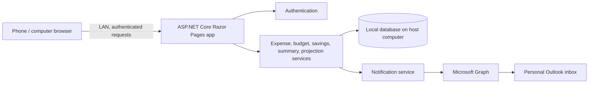

# Personal Expense and Savings App — Implementation Plan

**Status:** Phase 4 in progress; category, expense, recurring expense, and monthly budget foundations are implemented  
**Last updated:** 2026-10-17  
**Related requirements:** [REQUIREMENTS.md](REQUIREMENTS.md)

**Automated test progress (2026-10-17):** Added the `tests/PersonalFinance.Web.Tests` xUnit project. The initial 12 unit and SQLite functional tests pass with `dotnet test --configuration Release`, including recurrence calendar rules, real migration application, catch-up behavior, duplicate prevention, and preserving generated expense history after schedule deletion. The test project uses disposable in-memory databases, not the personal finance database. See [docs/testing.md](docs/testing.md).

**Phase 4 progress (2026-10-17):** Added monthly budgets for each payment type and user category, current-month usage/remaining summaries, persistent once-per-budget 85% and 100% crossing records, and automatic evaluation after expense changes plus a periodic background check. Outlook delivery remains planned for Phase 8. Added budget rule and SQLite functional tests; all 23 tests pass in Release configuration.

**Progress register (2026-10-11):** The existing SQLite schema and migrations are applied to `%LOCALAPPDATA%\PersonalFinance\personal-finance.db`; the newly generated recurring-expense migration will apply on the next app startup. Password setup/login/logout/change, secure cookie sessions, failed-login lockout, and host-only credential recovery are implemented. The user confirmed sign-in from Windows and Android through Caddy. Caddy remains a manually run executable, not a Windows service. Phase 3 includes user-managed categories, expense entry/edit/delete/history, a monthly dashboard, and recurring schedules. The app is currently running and holds its normal Debug output files; an isolated build completed with no warnings or errors.

**Startup fix (2026-10-11):** Removed a duplicate Kestrel listener declaration. Port `127.0.0.1:5080` is configured only in `appsettings.json`; the launch profile no longer injects a second URL. The reported startup collision was an app configuration conflict; Windows showed no external listener on port 5080.

**Authentication milestone (2026-10-11):** User completed first-run password setup and successfully signed in through Caddy from both the host browser and Android over the LAN. Automated authentication checks remain pending.

**Phase 3 progress (2026-10-11):** Added category create/rename/archive/restore, expense create/edit/delete with monthly history, and a current-month overview by payment type and category. Category archival preserves associations with past expenses. Deleting an expense permanently removes that record and updates totals; this behavior should be reviewed when alert history is added. Build succeeded with zero warnings/errors using a separate output directory because the running app holds the normal Debug files. Functional checks remain pending.

**Overview query fix (2026-10-11):** Reworked category total sorting to occur after the EF Core aggregate query materializes, avoiding a provider translation exception. The updated project builds with zero warnings/errors; runtime functional checks remain pending.

**Requirement updates (2026-10-11):** Added debit as a fourth payment type; enum-driven expense forms and dashboards include it automatically. Added optional fixed-amount recurring expenses with weekly, monthly, or yearly cadence and catch-up of every missed occurrence after downtime. The user confirmed these recurrence decisions.

**Recurring expenses (2026-10-11):** Added create/edit/delete schedule UI, automatic expense generation on due dates, one-minute processing while running, startup catch-up, duplicate protection, and generated-expense linkage. Added migration `AddRecurringExpenses`; it has not yet been applied to the user's database because the current app instance is running. Monthly day and yearly leap-date clamping rules are documented. Functional scheduler checks remain pending.

## 1. Delivery approach

Build a local-first web application in small, testable slices. First make the core expense and budget rules reliable; then add summaries, savings, and projections; then connect Outlook and prepare the app for use across the personal network.

The technical baseline below is selected for the first release. The component boundaries describe responsibilities; they do not require the UI and backend to be deployed as separate services.

## 2. Selected technical baseline

| Concern | Selected option |
| --- | --- |
| Host operating system | Windows 11 on the user's host computer |
| Client devices | Windows PC and Android phone, using a web browser |
| LAN HTTPS | Caddy reverse proxy on Windows, using Caddy's internal CA; trust the CA root on Windows and Android |
| Web application | ASP.NET Core Razor Pages on .NET 10 LTS |
| UI approach | Server-rendered responsive HTML/CSS with small amounts of JavaScript; no separate SPA frontend for the first release |
| Data access and database | Entity Framework Core 10 with SQLite; only the app process on the host opens the database |
| Outlook email | Microsoft Graph with delegated sign-in for the personal Microsoft account and `Mail.Send` permission |
| Test approach | .NET unit/integration tests plus browser-based end-to-end tests; live Outlook calls are manual tests, not automated test dependencies |

Razor Pages keeps this single-user forms-and-dashboard app in one deployable web application. SQLite stores data locally on the host; phones and other computers communicate with the app over HTTP(S) and never open the database file directly. .NET 10 is the selected LTS release; update to supported .NET 10 patches as part of maintenance.

**LAN HTTPS setup:** give the host a stable private-network address/name, then use Caddy as a local HTTPS reverse proxy with its internal certificate authority. Trust the public root certificate on Windows and Android; keep the CA private key on the host. During Phase 0, verify the actual Android browser accepts the certificate and confirm the Caddy service can reach the app on loopback. Do not expose the app to the public internet. Microsoft Graph requires outbound internet access for email delivery.

## 3. Proposed logical architecture

### Components and responsibilities

| Component | Responsibility | Main dependencies |
| --- | --- | --- |
| Razor Pages UI and application server | Render dashboard and forms; validate requests; apply authorization; expose app operations within one deployable ASP.NET Core app | Auth, domain services, database |
| Authentication | One-user password login, session lifecycle, password change/recovery strategy | Secure configuration and storage |
| Expense service | Validate and record MXN expenses with date, payment type, category, and description; support corrections | Categories, database |
| Recurring expense scheduler | Maintain optional recurring expense templates and create due expense entries, including catch-up after downtime | Expenses, schedule rules, host runtime |
| Category and budget service | User-managed categories; monthly per-type limits and per-category budgets; threshold state | Expenses, database |
| Summary service | Weekly, monthly, and yearly aggregations by amount, type, and category | Expenses, date rules |
| Savings service | Multiple monthly goals, contributions, monthly progress, contribution history | Database |
| Projection and suggestion service | Estimate month-end spend and remaining category allowance; show over-budget warnings | Expenses, budgets, savings |
| Notification service | Detect first crossing of 85% and 100% for each monthly budget; prevent duplicate sends | Budget service, email adapter, database |
| Outlook adapter | Authenticate with Microsoft and send alert messages using Microsoft Graph | Microsoft account/app registration, notification service |
| Local runtime and operations | Start/stop server, LAN binding, configuration, local data location, backup/restore | Host operating system, application server, database |

## 4. Recommended build order

Each phase has a completion gate. A phase is complete when its tests pass, its behavior is documented, and its acceptance points are demonstrated before starting dependent work.

### Phase 0 — Set up the selected stack and create the project skeleton

**Tasks**

- [x] Install the .NET 10 SDK on the Windows 11 development/host computer.
- [x] Create the initial solution (`PersonalFinance.slnx`) and ASP.NET Core Razor Pages project (`src/PersonalFinance.Web`). Keep a single deployable app; add domain/persistence/test projects when their boundaries are implemented.
- [x] Add EF Core 10 SQLite provider and define the local database path (`%LOCALAPPDATA%\PersonalFinance\personal-finance.db`, overridable with `FINANCE_DB_PATH`).
- Establish responsive layout conventions and shared navigation for phone and desktop browsers.
- Create the test project(s) and a basic automated startup/smoke-test path.
- [x] Reserve a stable private-network address for the host in the router (DHCP reservation preferred; completed by user).
- [x] Install the Caddy executable and write/validate `deploy/Caddyfile` for its internal CA and reverse proxy from reserved address `192.168.100.22` to `127.0.0.1:5080`.
- [ ] Install Caddy as a Windows service; LAN route is protected by authentication, but service installation and client certificate trust remain pending.
- [x] Trust Caddy's public root certificate on Windows and Android; never copy the CA private key to either client.
- [x] Verify HTTPS sign-in and proxy-to-app routing from Windows and Android browsers.
- Record Microsoft Graph app-registration and delegated OAuth setup for the personal Outlook account.
- Define configuration and secret storage; do not put secrets in source control.
- [x] Create development startup instructions and migration commands in `README.md`.

**Test**

- Fresh checkout can install dependencies and start a minimal app using documented steps.
- Automated smoke check confirms the Razor Pages app starts and responds.
- Confirm the app binds only to the intended interfaces and does not expose itself to the public internet by default.
- Verify secure access from both target clients: Windows PC and Android phone.

**Document**

- Architecture decision records for database, authentication/session handling, LAN transport, and Outlook auth; record the selected stack in this plan.
- [x] Initial project README with prerequisites and local development startup.

### Phase 1 — Data model and persistence

**Tasks**

- [x] Define schema and initial migration for expenses, categories, payment-type monthly limits, category budgets, savings goals, contributions, and alert-delivery state.
- [x] Store currency amounts as integer centavos to avoid binary floating-point money calculations.
- Define date and calendar-period behavior using the user's local calendar date.
- Define edit/delete behavior for expenses and contributions, including its effect on budget crossing state.

**Test**

- Database integration tests cover create/read/update/delete, constraints, date boundaries, and migration from an empty database.
- Verify money values round-trip exactly, including centavos.
- Verify data is written only to the configured local database path.

**Document**

- [x] Data dictionary and relationship diagram for the implemented category and expense entities.
- Migration and local database location/reset instructions.

### Phase 2 — Authentication and protected access

**Tasks**

- [x] Implement host-only first-run password setup, one-user login, and authenticated sessions.
- [x] Hash passwords with ASP.NET Core's password hasher; never store plaintext passwords.
- [x] Protect Razor Pages by default; add logout, a 12-hour secure cookie, and a 15-minute lockout after five failed attempts.
- [x] Implement password change and a host-run recovery command that clears only the credential.
- [x] Add and apply the authentication schema migration; migration generation and application both built successfully.
- [x] Manually verify first-run setup and sign-in through Caddy from the host and Android.
- [ ] Add automated authentication checks before installing Caddy as a service.

**Test**

- Unit/integration tests cover valid and invalid login, session expiry, logout, and every protected endpoint.
- Security checks confirm password hashes (not passwords) are stored and unauthenticated requests cannot access user data.
- Browser test verifies login works on a second LAN device/browser.

**Document**

- First-run password setup, change/recovery, and session behavior.
- Security assumptions and LAN access guidance.

### Phase 3 — Categories and expense entry/history

**Tasks**

- [x] Implement category create, rename, archive/restore policy, and selection.
- [x] Implement expense entry and month-filtered history with amount, date, payment type, category, and description.
- [x] Include cash, credit card, voucher card, and debit as payment types in entry and summaries.
- [x] Add validation and correction flows for expenses (edit or permanently delete).
- [x] Show current-month totals by payment type and category as a dashboard foundation.
- [x] Implement periodic expense templates with fixed amounts, weekly/monthly/yearly cadence, automatic creation, and catch-up after downtime.
- [x] Add a migration for recurring templates and the source link on generated expenses.
- [ ] Apply that migration on restart and confirm the existing SQLite records remain available.
- [x] Build category, expense, and recurring expense implementation (zero warnings/errors; isolated configuration used while the running app held Debug files).
- [ ] Complete the planned category/expense functional checks; document the data and correction behavior.
- [x] Add an automated test project with isolated recurrence-date unit tests and SQLite-backed functional checks for migration, expense generation/catch-up, duplicate prevention, and schedule deletion.
- [x] Run the automated suite on the current development machine: 12 tests passed in Release configuration.

**Test**

- Unit tests cover input validation, positive amounts, MXN precision, and category/payment-type rules.
- API/database tests cover creating, listing, editing, and deleting/voiding expenses.
- Recurrence unit and SQLite functional tests are implemented in `tests/PersonalFinance.Web.Tests`; run them with `dotnet test --configuration Release`.
- UI test covers entering and finding cash, credit-card, voucher-card, and debit expenses.
- Scheduler tests cover first due date, weekly recurrence, monthly day clamping, leap-day yearly recurrence, downtime catch-up, and duplicate prevention.

**Document**

- [x] Expense fields, category lifecycle, recurring schedules, and how corrections affect recorded history in `docs/data-model.md`.

### Phase 4 — Monthly budgets and threshold events

**Tasks**

- [x] Configure a monthly limit for each of the four payment types.
- [x] Configure monthly category budgets aggregated across payment types.
- [x] Calculate used amount and remaining amount for each budget.
- [x] Detect first crossings at 85% and 100%; persist threshold state per budget/month to avoid duplicate alerts.
- [x] Define correction behavior when an expense is edited/deleted after a threshold crossing: retain the recorded threshold event; never retract a crossing already recorded or potentially delivered.
- [x] Add a budget screen and automatic threshold evaluation after expense changes and during periodic background processing.

**Test**

- [x] Unit tests cover below/equal/above 85% and 100%, exact boundaries, one large expense crossing both, zero budgets, and invalid negative spending.
- [x] SQLite functional tests verify category totals combine payment types and type totals remain separate.
- [x] Repeated processing does not create duplicate threshold events; correction leaves previously recorded event history intact.
- [x] Month changes use separate budget and event records while preserving prior-month history.
- [ ] Manually verify the Budgets screen on Windows and Android after restarting the app.

**Document**

- [x] Budget math, calendar-month reset behavior, correction behavior, and threshold crossing/deduplication rules in `docs/data-model.md` and `docs/testing.md`.

### Phase 5 — Weekly, monthly, and yearly summaries

**Tasks**

- Build summary queries and views by amount, payment type, and category.
- Implement Monday–Sunday weeks and calendar month/year ranges.
- Support navigation between periods and empty-period display.

**Test**

- Unit tests cover Monday/Sunday boundaries, month/year boundaries, leap years, and local-date interpretation.
- Integration tests compare displayed totals with known expense fixtures across categories and payment types.
- UI tests navigate all three period types and verify grouping and totals.

**Document**

- Summary definitions and examples of the week/month/year boundaries.

### Phase 6 — Monthly savings goals and contribution history

**Tasks**

- Create, edit, and archive multiple goals with a monthly target.
- Record contributions against a goal and display monthly progress.
- Start new monthly progress each month while retaining prior contribution history.

**Test**

- Unit tests cover goal progress, target reached/exceeded, month rollover, and contribution date handling.
- Integration tests verify prior months remain reviewable after rollover.
- UI test creates multiple goals, records contributions, and reviews history.

**Document**

- Goal lifecycle, contribution rules, and monthly history behavior.

### Phase 7 — Projections and planning suggestions

**Tasks**

- Project month-end payment-type and category spending from current-month pace.
- Warn when projection exceeds a monthly budget.
- Show a reasonable remaining daily/weekly spend allowance for categories.
- Incorporate monthly savings targets into guidance, without treating contributions as expenses unless explicitly decided.
- Define behavior early in the month and when there is no spending history.

**Test**

- Unit tests cover projection math, month length, current date, no-spend cases, and budget overrun warnings.
- Tests verify category guidance uses the category budget and aggregated category spending.
- UI tests cover under-budget, projected-over-budget, and no-data states.
- Review example scenarios manually with hand-calculated expected results.

**Document**

- Projection formula, assumptions, limitations, and sample calculations.

### Phase 8 — Outlook email delivery

**Tasks**

- Implement Outlook sign-in/consent through Microsoft identity platform and send through Microsoft Graph.
- Store refresh/access credentials securely on the host; provide disconnect/reconnect behavior.
- Send minimal alert content for the first 85% and 100% crossing events.
- Record delivery success/failure and provide a way to retry a failed notification without generating duplicate successful alerts.
- Keep budget logic independent from the Microsoft Graph adapter so it can be tested without real email.

**Test**

- Unit tests use a mocked email adapter to verify the right content and threshold event are sent.
- Integration tests cover token unavailable/expired, Graph errors, retry, and success-state persistence.
- Manual end-to-end test with the user's consent sends a test email to the user's Outlook inbox and checks Sent Items.
- Never require live Microsoft credentials in automated test runs.

**Document**

- Outlook setup/consent, permissions requested, token storage, reconnect steps, and troubleshooting.
- Alert email examples and delivery retry behavior.

### Phase 9 — LAN deployment, backup, and release readiness

**Tasks**

- Add a reliable host startup/shutdown process and clear LAN address discovery.
- Configure firewall guidance and ensure no public/internet-facing exposure by default.
- Implement and verify local backup/export and restore (decision in requirements open items).
- Add health/status view, structured local logs, and graceful behavior when internet/email is unavailable.
- Validate responsive layouts on phone and desktop browsers.

**Test**

- End-to-end test from a second device on the personal network: authenticate, record expense, view summaries, and record a contribution.
- Verify the local HTTPS certificate is trusted and the app works in the intended browser on both Windows and Android.
- Backup/restore test reproduces expenses, budgets, goals, history, and notification state.
- Restart test confirms local data persists and alerts are not resent incorrectly.
- Network test confirms the app is not reachable from outside the intended network under the documented setup.
- Manual acceptance run follows the user stories in Section 5.

**Document**

- Install/start/stop/update instructions, LAN connection instructions, backup/restore, firewall guidance, and troubleshooting.
- Release checklist and known limitations.

## 5. Test strategy

Use a test pyramid and keep business rules testable without the browser or Microsoft services:

1. **Unit tests:** money handling, date ranges, budget math, thresholds, deduplication, savings progress, projection formulas.
2. **Database/API integration tests:** persistence, migrations, authorization, category aggregation, summaries, history, and notification state.
3. **UI/component tests:** forms, validation messages, navigation, empty/loading/error states, responsive views.
4. **End-to-end tests:** core user journeys in a real browser against a local test database.
5. **Manual external-service tests:** Microsoft sign-in and email delivery, performed explicitly with the user's account; never make CI depend on Outlook.
6. **Operational tests:** LAN access, restart persistence, backup/restore, and external-network exposure.

Every defect fix should add or update a test at the layer that reproduces it. Keep tests deterministic with a fixed clock and temporary database. Use fake email delivery in automated tests.

## 6. Core acceptance journeys

- Log in from a browser on the host and from another device on the personal network.
- Create categories and monthly category budgets; configure all four payment-type limits.
- Record expenses and confirm category/type/month totals update correctly.
- Cross 85% and 100% for both a category budget and a payment-type limit; verify one email for each threshold and no duplicates.
- Review Monday–Sunday, monthly, and yearly summaries with correct amount/type/category breakdowns.
- Create multiple monthly savings goals, record contributions, cross into a new month, and review prior contributions.
- View a forecast and category allowance for budgets that are on track and projected to exceed limits.
- Restart the host and confirm all local data remains available.

## 7. Documentation to maintain

Keep these project documents current as implementation proceeds:

- `REQUIREMENTS.md` — user-facing behavior and agreed scope.
- `IMPLEMENTATION_PLAN.md` — architecture components, sequence, tests, and completion gates.
- `README.md` — prerequisites, setup, local development, LAN use, and routine operation.
- `docs/architecture/` — architecture decisions and diagrams.
- `docs/data-model.md` — schema, relationships, money/date rules, and migrations.
- `docs/testing.md` — test commands, test layers, test data, and external-service test procedure.
- `docs/operations.md` — configuration, Outlook connection, security, backups, restore, and troubleshooting.

Update the relevant documentation in the same phase that changes the behavior. Treat undocumented behavior as unfinished.

## 8. Decisions still to confirm

1. Verify the selected Caddy/internal-CA HTTPS setup in Windows and Android browsers; authenticate from both devices.
2. Decide expense/contribution edit and delete semantics, especially after an alert has been sent.
3. Choose backup/export expectations.
4. Confirm allowance units (daily, weekly, or user-selectable) and the early-month projection rule.
5. Confirm email alert contents and secure Microsoft token storage approach.
6. Decide whether the host app should start automatically when Windows starts.

