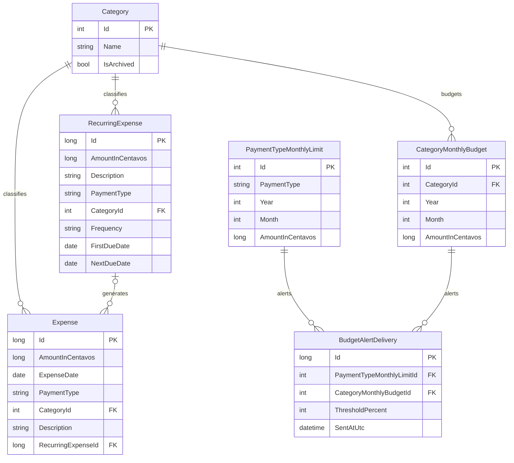

# Data model: categories and expenses

## Relationships

## Fields and rules

| Entity | Field | Rule |
| --- | --- | --- |
| Category | Name | Required, 1–100 characters after trimming; case-insensitive unique name. |
| Category | IsArchived | Archived categories remain attached to historical expenses and are omitted from new expense selections. |
| Expense | AmountInCentavos | Positive integer cents; form accepts MXN with at most two decimal places. |
| Expense | ExpenseDate | Calendar date without time; used as entered and grouped by local calendar month. |
| Expense | PaymentType | Cash, credit card, voucher card, or debit. |
| Expense | CategoryId | Required reference to a category. An archived category can remain on an existing expense during editing. |
| Expense | Description | Required, up to 500 characters. |
| Expense | RecurringExpenseId | Optional schedule reference for entries created automatically. Deleting a schedule clears this reference but retains the expense. |
| RecurringExpense | AmountInCentavos | Fixed positive amount copied to every generated expense. |
| RecurringExpense | Frequency | Weekly, monthly, or yearly. |
| RecurringExpense | FirstDueDate | The first generated date; new schedules cannot start in the past. |
| RecurringExpense | NextDueDate | The next due date to generate; advanced transactionally with the expense insertion to prevent duplicates. |
| PaymentTypeMonthlyLimit | PaymentType, Year, Month | One separate limit for each payment type and calendar month. |
| CategoryMonthlyBudget | CategoryId, Year, Month | One limit per category and calendar month; spending adds expenses from all payment types. |
| BudgetAlertDelivery | Budget reference, ThresholdPercent | Exactly one type/category budget reference and a threshold of 85 or 100. A row is created once the threshold is first reached in that budget month. `SentAtUtc` remains empty until Outlook delivery is implemented. |

## Corrections and views

Expenses can be edited or permanently deleted. Editing updates the amount/date/type/category/description on the same record. Deleting removes the record, so displayed totals recalculate from the remaining data. Category archival does not delete category or expense history. Monthly expense history can be browsed by calendar month; the overview shows current-month totals by payment type and category.

All money is stored as integer centavos in SQLite. Views format amounts as MXN using two decimal places. Weekly and yearly summaries are planned for Phase 5. Outlook delivery is planned for Phase 8.

The recurring expense worker processes due schedules when the app starts and once per minute while it is running. Each missed occurrence becomes a separate expense using its scheduled date. Monthly schedules retain their original day, clamped to the month's final day when necessary; yearly schedules retain their original month/day, with February 29 clamped to February 28 during non-leap years. If a category is archived after a recurring schedule uses it, the schedule can still create entries in that historical category.

Monthly budgets use local calendar dates and store money in centavos. Payment-type budgets aggregate expenses for one payment type; category budgets aggregate every payment type. The threshold processor runs after expense create/edit/delete, when the budget screen loads, and periodically in the background. Threshold crossing rows are retained if later expense corrections lower spending; sent notifications cannot be recalled. Updating a budget does not reset its already-recorded threshold events. A new calendar month uses separate budget and alert rows, preserving prior months.
